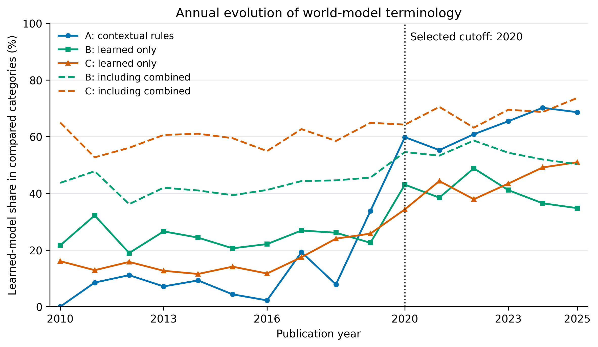
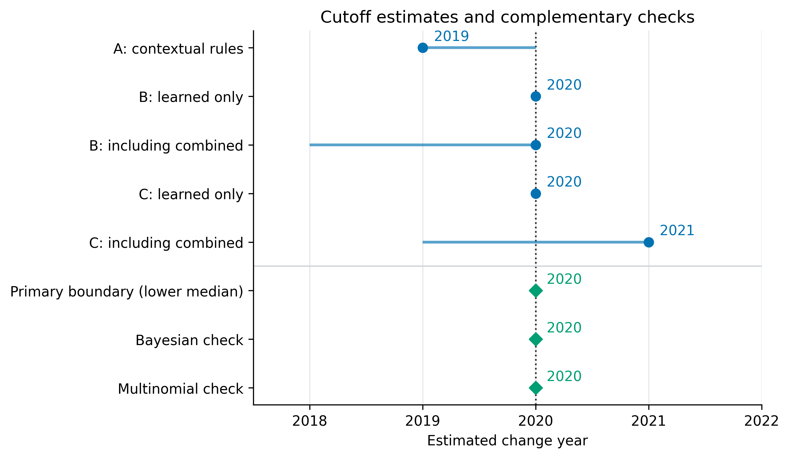
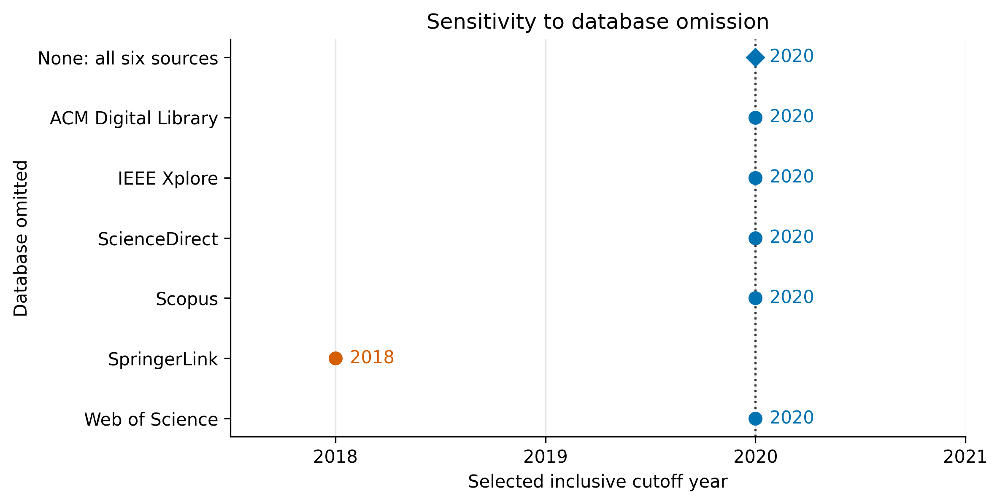

# Foundation and World Models for Outdoor Robot Navigation: A Systematic Review

This repository contains the bibliometric analysis supporting the review's inclusive **2020 publication-year cutoff**: processing scripts, saved results, and figures explaining the decision and its sensitivity.

## 1. Sources and corpus preparation

Records were obtained from six bibliographic sources:

| Source | Records before cross-database deduplication |
| --- | ---: |
| ACM Digital Library | 2,581 |
| IEEE Xplore | 702 |
| ScienceDirect | 191 |
| Scopus | 10,817 |
| SpringerLink | 5,278 |
| Web of Science | 819 |
| **Total** | **20,388** |

Platform export limits required batch downloads, including publication-year ranges for ACM and SpringerLink. The **18 export files are download batches, not separate searches**.

- [prepare_exports.py](bibliometrics/analysis/scripts/prepare_exports.py) consolidates these files into seven inputs, removing overlapping exports. ScienceDirect retains two input files; the other databases have one each.
- [corpus.py](bibliometrics/analysis/scripts/corpus.py) reads the bibliographic fields, normalizes identifiers and titles, and removes cross-database duplicates. Conflicting publication years are resolved using the earliest observed year.

| Processing result | Records |
| --- | ---: |
| Duplicates removed | 2,279 |
| Publications remaining after deduplication | 18,109 |
| Publications without a year | 11 |
| Publications remaining with a year | 18,098 |
| **Publications from 2010–2025 used in the temporal analysis** | **10,593** |

The analysis starts in **2010** to focus on the recent evolution of learned predictive models while retaining a pre-2020 comparison period. It includes complete years through **2025**; **2026 is excluded because the year is incomplete**. Earlier publications remain in the full corpus, and undated records are excluded from the annual calculations.

Source counts and export integrity information are available in [sources.csv](bibliometrics/analysis/results/sources.csv) and [provenance.json](provenance.json).

## 2. Annual terminology trends

Titles, abstracts, and keywords, when available, are classified using contextual rules (A) and two text classifiers (B and C). Five annual series compare learned predictive models with explicit representations, with and without combined representations. Ambiguous and unrelated records are excluded from these proportions.



B and C use related architectures, and their inputs are limited to 192 tokens. SpringerLink exports lack abstracts and keywords, making available text another source of sensitivity.

## 3. Selecting 2020

The five primary change-year estimates are **2019, 2020, 2020, 2020, and 2021**. Their median is **2020**, also selected by the Bayesian and multinomial checks. These calculations reuse data and are not independent confirmations. Segmented regression gives 2022 as a secondary diagnostic but does not enter the decision rule.



Bars show compatible years for the primary series; markers show selected estimates. The full decision rule and calculations are documented in [cutoff_method.md](docs/cutoff_method.md) and [summary.json](bibliometrics/analysis/results/cutoff/summary.json).

## 4. Database sensitivity



**2020 is retained in five of six database-omission checks; removing SpringerLink gives 2018.** The result supports a reproducible scope boundary for this corpus, not a universal historical turning point.

## 5. Reproduce the results

With Python 3.10 or later, from the repository root:

```bash
python -m pip install -r requirements.txt
python scripts/reproduce.py
```

This reuses saved classifications, recalculates the cutoff, regenerates the figures, and checks the numerical results. For a corpus rebuild, add `--from-raw` and supply the original exports listed in `provenance.json`; those exports are excluded from Git. Additional inference requirements and limitations are explained in the [method documentation](docs/cutoff_method.md).

## License

Code and original documentation: [Apache License 2.0](LICENSE). Third-party bibliographic material retains its original terms.
